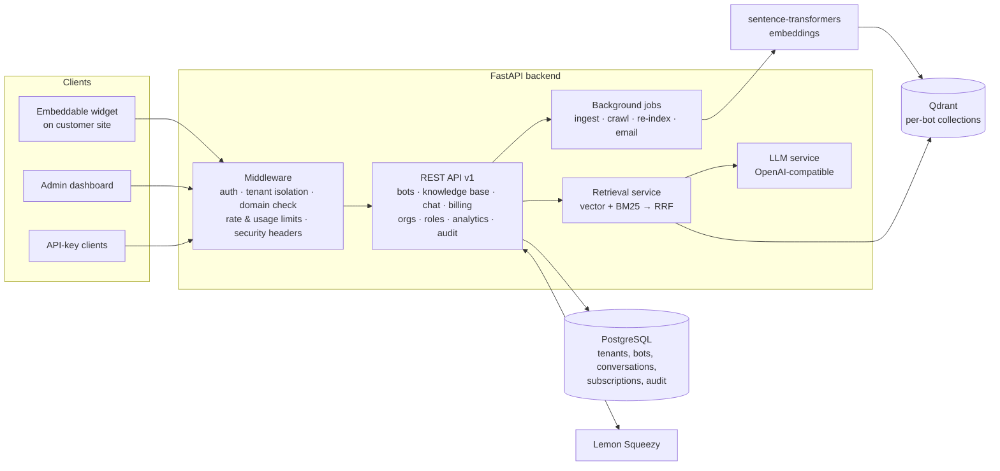

# Multi-Tenant RAG Chatbot Platform

[](https://github.com/Muhammad-Danyal353/multi-tenant-rag-chatbot/actions/workflows/ci.yml)


Backend for a SaaS platform where organizations create AI chatbots trained on their own knowledge (documents, websites and text), then embed them on their sites. Each organization is fully isolated, and answers are grounded in retrieved sources with attribution.

> This repository contains the **backend (FastAPI) and the RAG engine**. The admin dashboard was built on a commercial UI template and is not included.

## Features

**Retrieval-augmented generation**
- **Hybrid search**: Qdrant vector similarity + BM25 keyword search, merged with **Reciprocal Rank Fusion** (RRF), then similarity thresholding and de-duplication
- **Source attribution** on every answer
- Ingestion from **PDF, DOCX, TXT and Markdown** uploads, **website crawling** (sitemap discovery, robots.txt compliance, page limits) and plain text
- Configurable chunking and batch embedding with local `sentence-transformers/all-MiniLM-L6-v2` (384-dim), no paid embedding API needed
- Any OpenAI-compatible LLM endpoint (OpenAI, OpenRouter, …) with a configurable model list
- Fallback answers, suggested questions and multi-language responses

**Multi-tenant SaaS**
- Organizations with **tenant-isolation middleware**, team invitations and **role-based access control**
- JWT auth (access + refresh tokens), **API keys** for programmatic access
- **Embeddable chat widget** served per bot, with **domain allow-listing**
- **Usage limits** per plan, rate limiting (general and widget-specific)
- **Billing** with Lemon Squeezy (checkout, webhooks, subscription lifecycle)
- **Audit log**, activity feed and **analytics** (conversations, usage, bot performance)
- Background jobs for ingestion, crawling, re-indexing and email

## Architecture



**Chat request flow:** the widget sends a message → domain and rate checks → hybrid retrieval from the bot's Qdrant collection → context + history go to the LLM → answer with source attribution → conversation and analytics events stored in Postgres.

## Tech stack

| Area | Tools |
|---|---|
| API | FastAPI, Pydantic v2, Uvicorn |
| Data | PostgreSQL, SQLAlchemy 2.0, Alembic |
| Retrieval | Qdrant, BM25, Reciprocal Rank Fusion, sentence-transformers |
| LLM | OpenAI SDK (any OpenAI-compatible provider) |
| Ingestion | PyPDF2, python-docx, BeautifulSoup, lxml |
| Auth & security | JWT (python-jose), bcrypt, API keys, RBAC |
| Billing | Lemon Squeezy |
| Testing | pytest, pytest-asyncio |

## Quick start

Requirements: Python 3.10+, Docker.

```bash
# 1. Start Postgres and Qdrant
docker compose up -d

# 2. Install the backend
cd backend
python -m venv .venv
source .venv/bin/activate          # Windows: .venv\Scripts\activate
pip install -r requirements.txt

# 3. Configure
cp .env.example .env               # set OPENAI_API_KEY, JWT_SECRET_KEY, POSTGRES_PASSWORD=postgres

# 4. Create the schema and run
alembic upgrade head
uvicorn app.main:app --reload
```

Open the interactive API docs at http://localhost:8000/docs.

The embedding model downloads on first use. To use OpenRouter instead of OpenAI, set `OPENAI_BASE_URL=https://openrouter.ai/api/v1`.

## Configuration

All settings are environment variables. See [`backend/.env.example`](backend/.env.example).

| Variable | Purpose |
|---|---|
| `POSTGRES_*` | Database connection |
| `QDRANT_HOST`, `QDRANT_PORT`, `QDRANT_API_KEY` | Vector store |
| `OPENAI_API_KEY`, `OPENAI_BASE_URL`, `DEFAULT_LLM_MODEL` | LLM provider and model |
| `JWT_SECRET_KEY` | Token signing |
| `SMTP_*`, `EMAIL_FROM` | Invitation and notification emails |
| `LEMONSQUEEZY_*` | Billing (optional for local use) |
| `CORS_ORIGINS`, `FRONTEND_URL` | Dashboard origin |

## Project structure

```
backend/
├── app/
│   ├── api/v1/routes/     # 24 route modules: auth, bots, chat, knowledge_base, widget, billing, …
│   ├── core/              # security, middleware (tenant isolation, domain validation, usage limits)
│   ├── db/models/         # SQLAlchemy models
│   ├── schemas/           # Pydantic request/response schemas
│   ├── services/          # retrieval, embeddings, Qdrant, LLM, scraper, billing, analytics, …
│   ├── tasks/             # ingestion, crawling, re-index and email jobs
│   └── main.py
├── migrations/            # Alembic
├── scripts/               # search benchmark, BM25 verification
└── tests/                 # pytest suite
docs/                      # architecture, RAG design, indexing, billing, how-to guides
```

## Testing

```bash
cd backend
pytest
```

Most tests are integration tests and expect Postgres and Qdrant running (`docker compose up -d`). CI checks that the whole codebase compiles on every push.

## Documentation

- [System architecture](docs/system-architecture.md)
- [RAG architecture](docs/rag-architecture.md)
- [Qdrant indexing](docs/qdrant-indexing.md)
- [API response format](docs/api-response-format.md)
- [Background jobs](docs/background-jobs.md)
- [Billing with Lemon Squeezy](docs/billing-lemon-squeezy.md)
- How-to: [migrations](docs/how-to/run-migrations.md) · [Qdrant](docs/how-to/run-qdrant.md) · [SMTP](docs/how-to/setup-smtp.md) · [roles & permissions](docs/how-to/roles-and-permissions.md)

## License

[MIT](LICENSE) © HM Danyal Sajid
