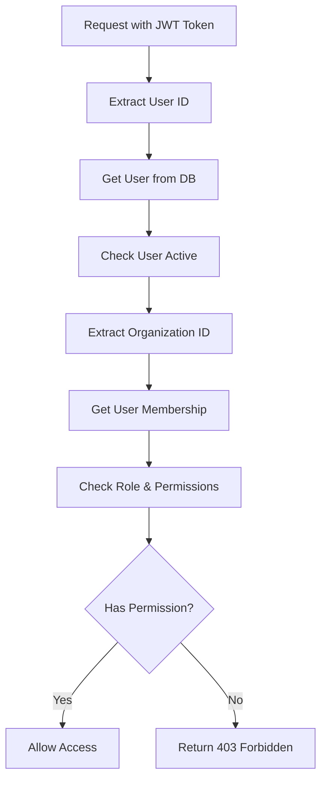

Let me analyze how roles and permissions are implemented in the current system by examining the relevant files.


[3 tools called]

Now let me search for more specific information about how permissions are used in the API routes:


[2 tools called]

Based on my analysis of the codebase, here's a comprehensive overview of how **Roles and Permissions (RBAC)** are implemented in Phase 3:

## 🔐 **RBAC Implementation Overview**

### **1. Role Hierarchy Structure**

The system implements a **4-tier role hierarchy** with clear permission boundaries:

```python
# From app/db/models/organization.py
class MemberRole(str, enum.Enum):
    OWNER = "owner"        # Full organization control
    ADMIN = "admin"        # Management permissions
    MEMBER = "member"      # Standard user permissions  
    VIEWER = "viewer"      # Read-only permissions
```

### **2. Permission System Architecture**

#### **Permission Format:**
- **Resource:Action** pattern (e.g., `"bot:create"`, `"kb:view"`)
- **Wildcard support** (e.g., `"bot:*"` grants all bot permissions)

#### **Role-Based Permissions:**
```python
# From app/core/dependencies.py
role_permissions = {
    "admin": [
        "bot:*", "kb:*", "member:invite",
        "analytics:view", "chat:view"
    ],
    "member": [
        "bot:create", "bot:edit", "bot:view",
        "kb:manage", "kb:view", "chat:view"
    ],
    "viewer": [
        "bot:view", "kb:view", "analytics:view", "chat:view"
    ]
}
```

### **3. Multi-Tenant Architecture**

#### **Organization-Based Isolation:**
- Each user belongs to **organizations** via `Membership` model
- **Tenant isolation** through organization context
- **X-Organization-ID** header for multi-tenant requests

#### **Membership Model:**
```python
class Membership(Base, TimestampMixin):
    user_id = Column(String(36), ForeignKey("users.id"))
    organization_id = Column(String(36), ForeignKey("organizations.id"))
    role = Column(SQLEnum(MemberRole), default=MemberRole.MEMBER)
    invited_by = Column(String(36), ForeignKey("users.id"))
```

### **4. Permission Enforcement Mechanisms**

#### **A. Dependency Injection Classes:**

**1. `RequirePermission` Class:**
```python
# Usage in endpoints:
@app.get("/bots")
def list_bots(user = Depends(RequirePermission("bot:view"))):
    # Only users with bot:view permission can access
```

**2. `RequireRole` Class:**
```python
# Usage in endpoints:
@app.get("/admin")
def admin_route(user = Depends(RequireRole(["owner", "admin"]))):
    # Only owners and admins can access
```

**3. `require_super_admin` Function:**
```python
# For platform-level operations
@app.get("/platform/stats")
def platform_stats(user = Depends(require_super_admin)):
    # Only super admins can access
```

#### **B. Permission Checking Logic:**
```python
def _has_permission(self, role: str, permission: str) -> bool:
    # Super admin has all permissions
    if role == "super_admin":
        return True
    
    # Owner has all organization permissions
    if role == "owner":
        return True
    
    # Check role-specific permissions
    permissions = role_permissions.get(role, [])
    
    # Support wildcard permissions (e.g., "bot:*")
    if f"{resource}:*" in permissions:
        return True
    
    return False
```

### **5. Authentication Flow with RBAC**

<svg aria-roledescription="flowchart-v2" role="graphics-document document" viewBox="-7.999996185302734 -8 341.3125 862.3765869140625" style="max-width: 341.3125px;" xmlns="http://www.w3.org/2000/svg" width="100%" id="mermaid-svg-1760552016896-jaqn4ua15"><style>#mermaid-svg-1760552016896-jaqn4ua15{font-family:"trebuchet ms",verdana,arial,sans-serif;font-size:16px;fill:#cccccc;}#mermaid-svg-1760552016896-jaqn4ua15 .error-icon{fill:#5a1d1d;}#mermaid-svg-1760552016896-jaqn4ua15 .error-text{fill:#f48771;stroke:#f48771;}#mermaid-svg-1760552016896-jaqn4ua15 .edge-thickness-normal{stroke-width:2px;}#mermaid-svg-1760552016896-jaqn4ua15 .edge-thickness-thick{stroke-width:3.5px;}#mermaid-svg-1760552016896-jaqn4ua15 .edge-pattern-solid{stroke-dasharray:0;}#mermaid-svg-1760552016896-jaqn4ua15 .edge-pattern-dashed{stroke-dasharray:3;}#mermaid-svg-1760552016896-jaqn4ua15 .edge-pattern-dotted{stroke-dasharray:2;}#mermaid-svg-1760552016896-jaqn4ua15 .marker{fill:#cccccc;stroke:#cccccc;}#mermaid-svg-1760552016896-jaqn4ua15 .marker.cross{stroke:#cccccc;}#mermaid-svg-1760552016896-jaqn4ua15 svg{font-family:"trebuchet ms",verdana,arial,sans-serif;font-size:16px;}#mermaid-svg-1760552016896-jaqn4ua15 .label{font-family:"trebuchet ms",verdana,arial,sans-serif;color:#cccccc;}#mermaid-svg-1760552016896-jaqn4ua15 .cluster-label text{fill:#e7e7e7;}#mermaid-svg-1760552016896-jaqn4ua15 .cluster-label span,#mermaid-svg-1760552016896-jaqn4ua15 p{color:#e7e7e7;}#mermaid-svg-1760552016896-jaqn4ua15 .label text,#mermaid-svg-1760552016896-jaqn4ua15 span,#mermaid-svg-1760552016896-jaqn4ua15 p{fill:#cccccc;color:#cccccc;}#mermaid-svg-1760552016896-jaqn4ua15 .node rect,#mermaid-svg-1760552016896-jaqn4ua15 .node circle,#mermaid-svg-1760552016896-jaqn4ua15 .node ellipse,#mermaid-svg-1760552016896-jaqn4ua15 .node polygon,#mermaid-svg-1760552016896-jaqn4ua15 .node path{fill:#1e1e1e;stroke:#6b6b6b;stroke-width:1px;}#mermaid-svg-1760552016896-jaqn4ua15 .flowchart-label text{text-anchor:middle;}#mermaid-svg-1760552016896-jaqn4ua15 .node .label{text-align:center;}#mermaid-svg-1760552016896-jaqn4ua15 .node.clickable{cursor:pointer;}#mermaid-svg-1760552016896-jaqn4ua15 .arrowheadPath{fill:#e1e1e1;}#mermaid-svg-1760552016896-jaqn4ua15 .edgePath .path{stroke:#cccccc;stroke-width:2.0px;}#mermaid-svg-1760552016896-jaqn4ua15 .flowchart-link{stroke:#cccccc;fill:none;}#mermaid-svg-1760552016896-jaqn4ua15 .edgeLabel{background-color:#1e1e1e99;text-align:center;}#mermaid-svg-1760552016896-jaqn4ua15 .edgeLabel rect{opacity:0.5;background-color:#1e1e1e99;fill:#1e1e1e99;}#mermaid-svg-1760552016896-jaqn4ua15 .labelBkg{background-color:rgba(30, 30, 30, 0.5);}#mermaid-svg-1760552016896-jaqn4ua15 .cluster rect{fill:#3a3d41;stroke:#303031;stroke-width:1px;}#mermaid-svg-1760552016896-jaqn4ua15 .cluster text{fill:#e7e7e7;}#mermaid-svg-1760552016896-jaqn4ua15 .cluster span,#mermaid-svg-1760552016896-jaqn4ua15 p{color:#e7e7e7;}#mermaid-svg-1760552016896-jaqn4ua15 div.mermaidTooltip{position:absolute;text-align:center;max-width:200px;padding:2px;font-family:"trebuchet ms",verdana,arial,sans-serif;font-size:12px;background:#4d4d4d;border:1px solid #007fd4;border-radius:2px;pointer-events:none;z-index:100;}#mermaid-svg-1760552016896-jaqn4ua15 .flowchartTitleText{text-anchor:middle;font-size:18px;fill:#cccccc;}#mermaid-svg-1760552016896-jaqn4ua15 :root{--mermaid-font-family:"trebuchet ms",verdana,arial,sans-serif;}</style><g><marker orient="auto" markerHeight="12" markerWidth="12" markerUnits="userSpaceOnUse" refY="5" refX="6" viewBox="0 0 10 10" class="marker flowchart" id="mermaid-svg-1760552016896-jaqn4ua15_flowchart-pointEnd"><path style="stroke-width: 1; stroke-dasharray: 1, 0;" class="arrowMarkerPath" d="M 0 0 L 10 5 L 0 10 z"/></marker><marker orient="auto" markerHeight="12" markerWidth="12" markerUnits="userSpaceOnUse" refY="5" refX="4.5" viewBox="0 0 10 10" class="marker flowchart" id="mermaid-svg-1760552016896-jaqn4ua15_flowchart-pointStart"><path style="stroke-width: 1; stroke-dasharray: 1, 0;" class="arrowMarkerPath" d="M 0 5 L 10 10 L 10 0 z"/></marker><marker orient="auto" markerHeight="11" markerWidth="11" markerUnits="userSpaceOnUse" refY="5" refX="11" viewBox="0 0 10 10" class="marker flowchart" id="mermaid-svg-1760552016896-jaqn4ua15_flowchart-circleEnd"><circle style="stroke-width: 1; stroke-dasharray: 1, 0;" class="arrowMarkerPath" r="5" cy="5" cx="5"/></marker><marker orient="auto" markerHeight="11" markerWidth="11" markerUnits="userSpaceOnUse" refY="5" refX="-1" viewBox="0 0 10 10" class="marker flowchart" id="mermaid-svg-1760552016896-jaqn4ua15_flowchart-circleStart"><circle style="stroke-width: 1; stroke-dasharray: 1, 0;" class="arrowMarkerPath" r="5" cy="5" cx="5"/></marker><marker orient="auto" markerHeight="11" markerWidth="11" markerUnits="userSpaceOnUse" refY="5.2" refX="12" viewBox="0 0 11 11" class="marker cross flowchart" id="mermaid-svg-1760552016896-jaqn4ua15_flowchart-crossEnd"><path style="stroke-width: 2; stroke-dasharray: 1, 0;" class="arrowMarkerPath" d="M 1,1 l 9,9 M 10,1 l -9,9"/></marker><marker orient="auto" markerHeight="11" markerWidth="11" markerUnits="userSpaceOnUse" refY="5.2" refX="-1" viewBox="0 0 11 11" class="marker cross flowchart" id="mermaid-svg-1760552016896-jaqn4ua15_flowchart-crossStart"><path style="stroke-width: 2; stroke-dasharray: 1, 0;" class="arrowMarkerPath" d="M 1,1 l 9,9 M 10,1 l -9,9"/></marker><g class="root"><g class="clusters"/><g class="edgePaths"><path marker-end="url(#mermaid-svg-1760552016896-jaqn4ua15_flowchart-pointEnd)" style="fill:none;" class="edge-thickness-normal edge-pattern-solid flowchart-link LS-A LE-B" id="L-A-B-0" d="M146.866,33.4L146.866,37.567C146.866,41.733,146.866,50.067,146.866,57.517C146.866,64.967,146.866,71.533,146.866,74.817L146.866,78.1"/><path marker-end="url(#mermaid-svg-1760552016896-jaqn4ua15_flowchart-pointEnd)" style="fill:none;" class="edge-thickness-normal edge-pattern-solid flowchart-link LS-B LE-C" id="L-B-C-0" d="M146.866,116.8L146.866,120.967C146.866,125.133,146.866,133.467,146.866,140.917C146.866,148.367,146.866,154.933,146.866,158.217L146.866,161.5"/><path marker-end="url(#mermaid-svg-1760552016896-jaqn4ua15_flowchart-pointEnd)" style="fill:none;" class="edge-thickness-normal edge-pattern-solid flowchart-link LS-C LE-D" id="L-C-D-0" d="M146.866,200.2L146.866,204.367C146.866,208.533,146.866,216.867,146.866,224.317C146.866,231.767,146.866,238.333,146.866,241.617L146.866,244.9"/><path marker-end="url(#mermaid-svg-1760552016896-jaqn4ua15_flowchart-pointEnd)" style="fill:none;" class="edge-thickness-normal edge-pattern-solid flowchart-link LS-D LE-E" id="L-D-E-0" d="M146.866,283.6L146.866,287.767C146.866,291.933,146.866,300.267,146.866,307.717C146.866,315.167,146.866,321.733,146.866,325.017L146.866,328.3"/><path marker-end="url(#mermaid-svg-1760552016896-jaqn4ua15_flowchart-pointEnd)" style="fill:none;" class="edge-thickness-normal edge-pattern-solid flowchart-link LS-E LE-F" id="L-E-F-0" d="M146.866,367L146.866,371.167C146.866,375.333,146.866,383.667,146.866,391.117C146.866,398.567,146.866,405.133,146.866,408.417L146.866,411.7"/><path marker-end="url(#mermaid-svg-1760552016896-jaqn4ua15_flowchart-pointEnd)" style="fill:none;" class="edge-thickness-normal edge-pattern-solid flowchart-link LS-F LE-G" id="L-F-G-0" d="M146.866,450.4L146.866,454.567C146.866,458.733,146.866,467.067,146.866,474.517C146.866,481.967,146.866,488.533,146.866,491.817L146.866,495.1"/><path marker-end="url(#mermaid-svg-1760552016896-jaqn4ua15_flowchart-pointEnd)" style="fill:none;" class="edge-thickness-normal edge-pattern-solid flowchart-link LS-G LE-H" id="L-G-H-0" d="M146.866,533.8L146.866,537.967C146.866,542.133,146.866,550.467,146.932,558C146.998,565.534,147.13,572.267,147.196,575.634L147.262,579.001"/><path marker-end="url(#mermaid-svg-1760552016896-jaqn4ua15_flowchart-pointEnd)" style="fill:none;" class="edge-thickness-normal edge-pattern-solid flowchart-link LS-H LE-I" id="L-H-I-0" d="M111.175,708.886L101.486,720.535C91.796,732.183,72.417,755.48,62.727,771.945C53.037,788.41,53.037,798.043,53.037,802.86L53.037,807.677"/><path marker-end="url(#mermaid-svg-1760552016896-jaqn4ua15_flowchart-pointEnd)" style="fill:none;" class="edge-thickness-normal edge-pattern-solid flowchart-link LS-H LE-J" id="L-H-J-0" d="M183.556,708.886L193.079,720.535C202.602,732.183,221.648,755.48,231.171,771.945C240.694,788.41,240.694,798.043,240.694,802.86L240.694,807.677"/></g><g class="edgeLabels"><g class="edgeLabel"><g transform="translate(0, 0)" class="label"><rect height="0" width="0" ry="0" rx="0"/><text style=""><tspan class="row" x="0" dy="1em" xml:space="preserve"/></text></g></g><g class="edgeLabel"><g transform="translate(0, 0)" class="label"><rect height="0" width="0" ry="0" rx="0"/><text style=""><tspan class="row" x="0" dy="1em" xml:space="preserve"/></text></g></g><g class="edgeLabel"><g transform="translate(0, 0)" class="label"><rect height="0" width="0" ry="0" rx="0"/><text style=""><tspan class="row" x="0" dy="1em" xml:space="preserve"/></text></g></g><g class="edgeLabel"><g transform="translate(0, 0)" class="label"><rect height="0" width="0" ry="0" rx="0"/><text style=""><tspan class="row" x="0" dy="1em" xml:space="preserve"/></text></g></g><g class="edgeLabel"><g transform="translate(0, 0)" class="label"><rect height="0" width="0" ry="0" rx="0"/><text style=""><tspan class="row" x="0" dy="1em" xml:space="preserve"/></text></g></g><g class="edgeLabel"><g transform="translate(0, 0)" class="label"><rect height="0" width="0" ry="0" rx="0"/><text style=""><tspan class="row" x="0" dy="1em" xml:space="preserve"/></text></g></g><g class="edgeLabel"><g transform="translate(0, 0)" class="label"><rect height="0" width="0" ry="0" rx="0"/><text style=""><tspan class="row" x="0" dy="1em" xml:space="preserve"/></text></g></g><g transform="translate(53.037498474121094, 778.7765760421753)" class="edgeLabel"><g transform="translate(-11.725000381469727, -9.199999809265137)" class="label"><rect height="18.400033950805664" width="23.437541961669922" ry="0" rx="0"/><text style=""><tspan class="row" x="0" dy="1em" xml:space="preserve">Yes</tspan></text></g></g><g transform="translate(240.6937484741211, 778.7765760421753)" class="edgeLabel"><g transform="translate(-9.50546932220459, -9.199999809265137)" class="label"><rect height="18.400033950805664" width="19.005857467651367" ry="0" rx="0"/><text style=""><tspan class="row" x="0" dy="1em" xml:space="preserve">No</tspan></text></g></g></g><g class="nodes"><g transform="translate(146.8656234741211, 16.700000762939453)" id="flowchart-A-18" class="node default default flowchart-label"><rect height="33.39999961853027" width="189" y="-16.699999809265137" x="-94.5" ry="0" rx="0" style="" class="basic label-container"/><g transform="translate(0, -9.199999809265137)" style="" class="label"><rect/><text style=""><tspan class="row" x="0" dy="1em" xml:space="preserve">Request with JWT Token</tspan></text></g></g><g transform="translate(146.8656234741211, 100.10000228881836)" id="flowchart-B-19" class="node default default flowchart-label"><rect height="33.39999961853027" width="122.5250015258789" y="-16.699999809265137" x="-61.26250076293945" ry="0" rx="0" style="" class="basic label-container"/><g transform="translate(0, -9.199999809265137)" style="" class="label"><rect/><text style=""><tspan class="row" x="0" dy="1em" xml:space="preserve">Extract User ID</tspan></text></g></g><g transform="translate(146.8656234741211, 183.50000381469727)" id="flowchart-C-21" class="node default default flowchart-label"><rect height="33.39999961853027" width="140.0250015258789" y="-16.699999809265137" x="-70.01250076293945" ry="0" rx="0" style="" class="basic label-container"/><g transform="translate(0, -9.199999809265137)" style="" class="label"><rect/><text style=""><tspan class="row" x="0" dy="1em" xml:space="preserve">Get User from DB</tspan></text></g></g><g transform="translate(146.8656234741211, 266.9000053405762)" id="flowchart-D-23" class="node default default flowchart-label"><rect height="33.39999961853027" width="143.4875030517578" y="-16.699999809265137" x="-71.7437515258789" ry="0" rx="0" style="" class="basic label-container"/><g transform="translate(0, -9.199999809265137)" style="" class="label"><rect/><text style=""><tspan class="row" x="0" dy="1em" xml:space="preserve">Check User Active</tspan></text></g></g><g transform="translate(146.8656234741211, 350.3000068664551)" id="flowchart-E-25" class="node default default flowchart-label"><rect height="33.39999961853027" width="181.71250915527344" y="-16.699999809265137" x="-90.85625457763672" ry="0" rx="0" style="" class="basic label-container"/><g transform="translate(0, -9.199999809265137)" style="" class="label"><rect/><text style=""><tspan class="row" x="0" dy="1em" xml:space="preserve">Extract Organization ID</tspan></text></g></g><g transform="translate(146.8656234741211, 433.700008392334)" id="flowchart-F-27" class="node default default flowchart-label"><rect height="33.39999961853027" width="168.25" y="-16.699999809265137" x="-84.125" ry="0" rx="0" style="" class="basic label-container"/><g transform="translate(0, -9.199999809265137)" style="" class="label"><rect/><text style=""><tspan class="row" x="0" dy="1em" xml:space="preserve">Get User Membership</tspan></text></g></g><g transform="translate(146.8656234741211, 517.1000099182129)" id="flowchart-G-29" class="node default default flowchart-label"><rect height="33.39999961853027" width="196.77500915527344" y="-16.699999809265137" x="-98.38750457763672" ry="0" rx="0" style="" class="basic label-container"/><g transform="translate(0, -9.199999809265137)" style="" class="label"><rect/><text style=""><tspan class="row" x="0" dy="1em" xml:space="preserve">Check Role &amp; Permissions</tspan></text></g></g><g transform="translate(146.8656234741211, 664.1882934570312)" id="flowchart-H-31" class="node default default flowchart-label"><polygon style="" transform="translate(-80.38828182220459,80.38828182220459)" class="label-container" points="80.38828182220459,0 160.77656364440918,-80.38828182220459 80.38828182220459,-160.77656364440918 0,-80.38828182220459"/><g transform="translate(0, -9.199999809265137)" style="" class="label"><rect/><text style=""><tspan class="row" x="0" dy="1em" xml:space="preserve">Has Permission?</tspan></text></g></g><g transform="translate(53.037498474121094, 829.6765766143799)" id="flowchart-I-33" class="node default default flowchart-label"><rect height="33.39999961853027" width="106.07500457763672" y="-16.699999809265137" x="-53.03750228881836" ry="0" rx="0" style="" class="basic label-container"/><g transform="translate(0, -9.199999809265137)" style="" class="label"><rect/><text style=""><tspan class="row" x="0" dy="1em" xml:space="preserve">Allow Access</tspan></text></g></g><g transform="translate(240.6937484741211, 829.6765766143799)" id="flowchart-J-35" class="node default default flowchart-label"><rect height="33.39999961853027" width="169.2375030517578" y="-16.699999809265137" x="-84.6187515258789" ry="0" rx="0" style="" class="basic label-container"/><g transform="translate(0, -9.199999809265137)" style="" class="label"><rect/><text style=""><tspan class="row" x="0" dy="1em" xml:space="preserve">Return 403 Forbidden</tspan></text></g></g></g></g></g></svg>




### **6. Current Implementation Status**

#### **✅ Fully Implemented:**
- **Role definitions** (OWNER, ADMIN, MEMBER, VIEWER)
- **Permission system** with resource:action format
- **Multi-tenant isolation** via organization context
- **Dependency injection** classes for permission checking
- **Super admin** access control
- **API key authentication** for widgets

#### **⚠️ Partially Implemented:**
- **API endpoints** still use placeholder implementations
- **Permission decorators** not yet applied to actual endpoints
- **Role management** endpoints (invite, remove members) not implemented

#### **❌ Not Yet Implemented:**
- **Role assignment** during user registration
- **Member invitation** system
- **Permission-based UI** filtering
- **Audit logging** for permission changes

### **7. Usage Examples**

#### **In API Endpoints (Future Implementation):**
```python
# Bot management - requires bot permissions
@router.post("/bots")
async def create_bot(
    user = Depends(RequirePermission("bot:create")),
    org = Depends(get_current_organization)
):
    # Only users with bot:create permission can create bots
    pass

# Admin operations - requires admin role
@router.get("/admin/members")
async def list_members(
    user = Depends(RequireRole(["owner", "admin"]))
):
    # Only owners and admins can list members
    pass

# Analytics - requires view permission
@router.get("/analytics")
async def get_analytics(
    user = Depends(RequirePermission("analytics:view"))
):
    # Only users with analytics:view permission can access
    pass
```

### **8. Security Features**

- **JWT-based authentication** with role information
- **Organization-scoped permissions** (tenant isolation)
- **API key authentication** for widget access
- **Domain validation** for widget security
- **Rate limiting** per API key
- **Audit logging** for security events

## 📊 **Summary**

The **RBAC system is architecturally complete** with:
- ✅ **4-tier role hierarchy** (Owner, Admin, Member, Viewer)
- ✅ **Granular permissions** with resource:action format
- ✅ **Multi-tenant isolation** via organization context
- ✅ **Dependency injection** for permission enforcement
- ✅ **Super admin** platform-level access
- ✅ **API key authentication** for widgets

The system is **ready for Phase 4** implementation where these permission classes will be applied to actual API endpoints for bot management, knowledge base operations, and analytics.